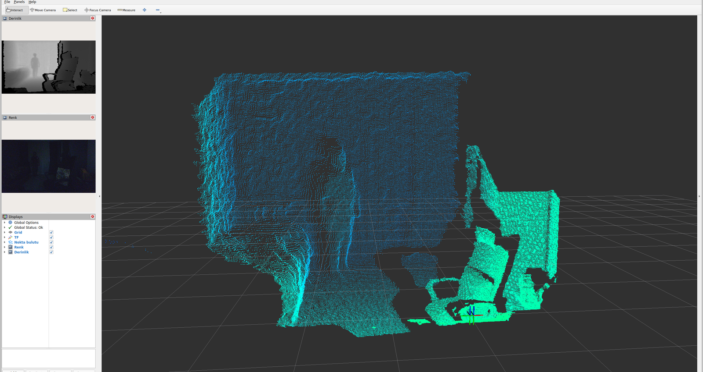
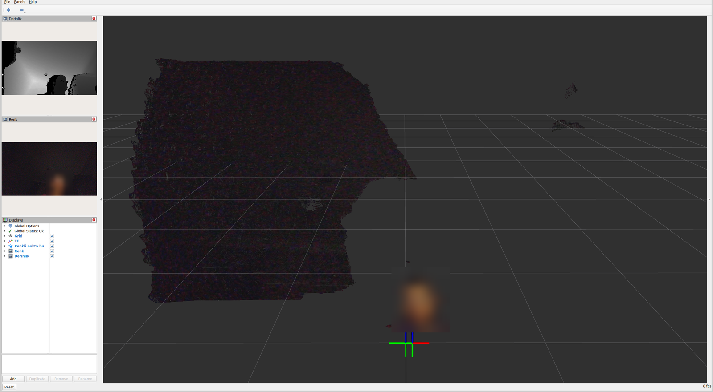
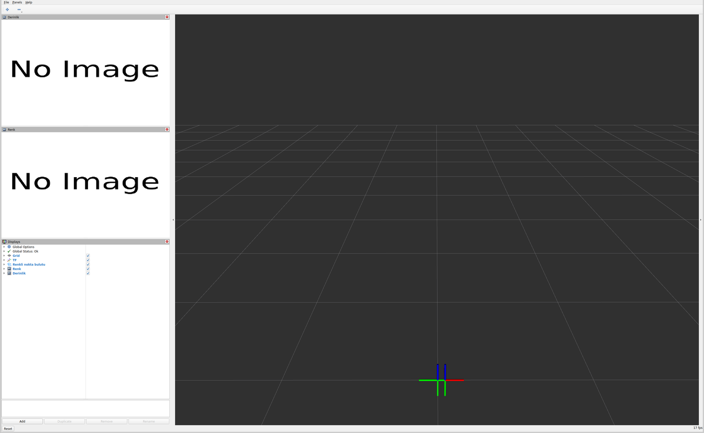
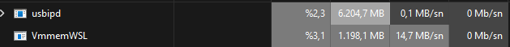
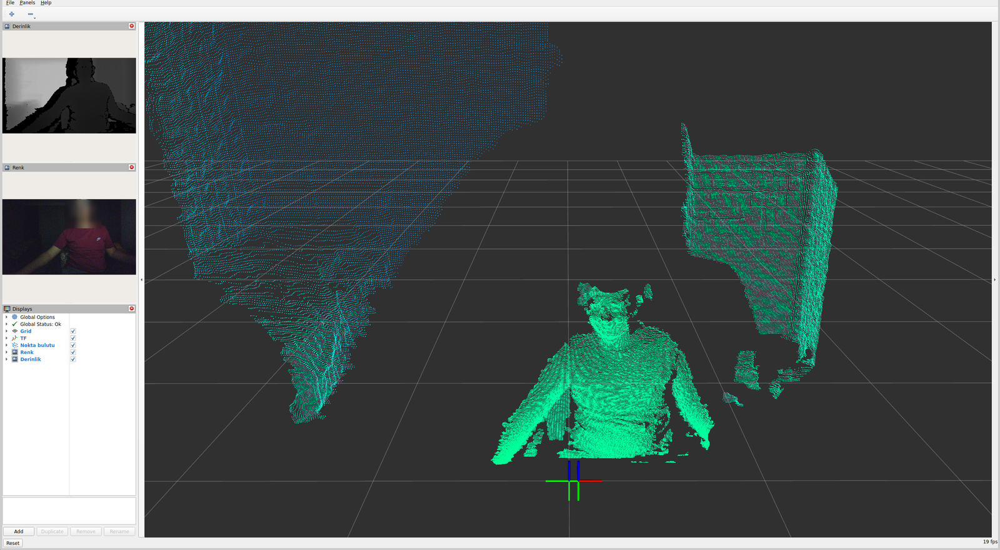

# Orbbec Gemini 335L ile ROS 2 + RViz — WSL2, Jetson ve Raspberry Pi

**[English](README.md)**

> Yepyeni bir **Orbbec Gemini 335L** kutudan çıkıp laptopta (Windows 11 + WSL2 Ubuntu 24.04 + ROS 2 Jazzy)
> RViz'de 30 Hz çalışana kadar yaşanan **her sorun, gerçek sebebi ve çözümü**; Jetson ve Raspberry Pi notlarıyla. Sorunların çoğu
> kameradan değil, aradaki katmanlardan (kablo, usbip, saat, DDS, grafik) çıktı.
> Her madde ölçülerek doğrulandı; ölçüm sayıları yanında.
>
> Bütün Gemini 330 serisine (330 / 335 / 335L / 336 / 336L …) küçük değişikliklerle uyar (USB ürün
> kimliği, çözünürlükler). Denenen: kamera firmware 1.2.81 → 1.8.10, `ros-jazzy-orbbec-camera` 2.9.3,
> OrbbecSDK v2.10.6, usbipd-win 5.3.0, WSL 2.7.3. Ekim 2026.



**Son çalışan durum (WSL):** renk 848×480 + derinlik 848×480 + nokta bulutu **30 Hz**, kamera düğümü
~%20 CPU, RViz ekran kartında, 40 sn ölçümde 0,3 sn'den uzun boşluk **0**.

---

## İçindekiler

1. [Dosyalar](#dosyalar)
2. [Hızlı başlangıç — WSL](#hızlı-başlangıç--wsl)
3. [Hızlı başlangıç — Jetson / Raspberry Pi](#hızlı-başlangıç--jetson--raspberry-pi)
4. [Sorun → sebep → çözüm](#sorun--sebep--çözüm) ← asıl değerli kısım
5. [Firmware güncelleme](#firmware-güncelleme)
6. [Ayar seçimleri ve gerekçeleri](#ayar-seçimleri-ve-gerekçeleri)
7. [RViz kullanımı](#rviz-kullanımı)

---

## Dosyalar

| Dosya | Ne yapar | Nerede |
|---|---|---|
| `wsl/start.sh` | Kamerayı bağlar, bekçiyi + sürücüyü + RViz'i açar | WSL |
| `wsl/stop.sh` | RViz, launch ve kamera düğümünü kapatır | WSL / Linux |
| `wsl/attach.sh` | Kamerayı usbipd ile WSL'ye **yeniden** bağlar (detach → attach, tekrar dener) | WSL |
| `wsl/usbipd_watchdog.sh` | `usbipd.exe` belleğini 15 sn'de bir izler, >3 GB → kamerayı durdurur | WSL |
| `linux/setup.sh` | Paket + udev + sysctl, tek seferlik | Jetson / Pi |
| `linux/start.sh` | Sürücüyü Pi 5'te ölçülen ayarlarla arka planda başlatır (USB 2 bağlantı için `USB2=1`) | Jetson / Pi |
| `check.sh` | Aşağıdaki tuzakları tarar: OK / WARN / FAIL | hepsi |
| `config/gemini335l.rviz` | Nokta bulutu (uzaklığa göre renk) + renk + derinlik + araç çubuğu | hepsi |
| `config/cyclonedds.xml` | CycloneDDS alma tamponu ≥10 MB | hepsi (Cyclone kullanıyorsan) |

Betiklerin mesajları İngilizce.

---

## Hızlı başlangıç — WSL

**Bir kerelik kurulum:**

1. Windows: `winget install --exact dorssel.usbipd-win` (UAC çıkar).
2. WSL: `sudo apt install ros-jazzy-orbbec-camera ros-jazzy-orbbec-description`
3. WSL: udev kuralı →
   `sudo cp /opt/ros/jazzy/share/orbbec_camera/udev/99-obsensor-libusb.rules /etc/udev/rules.d/ && sudo udevadm control --reload-rules`
4. WSL: uvcvideo'yu kapat (sorun 3) →
   `echo "blacklist uvcvideo" | sudo tee /etc/modprobe.d/orbbec-uvcvideo-off.conf && sudo modprobe -r uvcvideo`
5. WSL: DDS tamponları (sorun 7) → `linux/setup.sh` içindeki `60-ros2-dds.conf` bloğunu elle uygula.
6. WSL: saat çekişmesi (sorun 8) → `sudo systemctl disable --now systemd-timesyncd`
7. Kamerayı **USB 3 kabloyla** tak (sorun 1), yönetici PowerShell'de:
   `usbipd list` → kameranın BUSID'si → `usbipd bind --busid <BUSID>`
8. Firmware eskiyse güncelle ([aşağıda](#firmware-güncelleme)). 1.2.81 ile hazır launch açılmıyor (sorun 5).

**Her seferinde:**

```bash
wsl/start.sh              # bağlar + kamera + RViz   (yalnız kamera: wsl/start.sh no_rviz)
wsl/stop.sh               # kapatır
./check.sh                # bir şey ters giderse önce bu
```

Kamerayı Windows'ta kullanmak için önce `usbipd detach --busid <BUSID>`.
**Başka porta takarsan BUSID değişir** → o port için `bind` bir kez daha (UAC).
Serinin başka bir kamerası için `ORBBEC_ID` ver (ör. `ORBBEC_ID=2bc5:0800 wsl/start.sh`; `usbipd list`'e bak).

---

## Hızlı başlangıç — Jetson / Raspberry Pi

Orada kamera doğrudan USB'de; WSL'ye özgü sorunlar (2, 3, 9, 10) **yok**. Geriye kalan tuzaklar:
USB 3 kablo (1), firmware (5), DDS tamponu (7), saat (8), işlemci yükü (6).

| Platform | Ubuntu / ROS 2 | Hazır paket (8 Eki 2026) |
|---|---|---|
| Jetson Orin (JetPack 6) | 22.04 / Humble | `ros-humble-orbbec-camera` 2.9.3 arm64 ✔ |
| Raspberry Pi 5 | 24.04 / Jazzy | `ros-jazzy-orbbec-camera` 2.9.3 arm64 ✔ |
| Raspberry Pi 5 | Raspberry Pi OS | ROS 2 hazır paketi **yok** → Docker'da Ubuntu/ROS ya da OrbbecSDK_v2'yi kaynaktan |

```bash
linux/setup.sh            # paket + udev + sysctl (bir kez)
# kamerayı çıkar-tak, sonra:
./check.sh
source /opt/ros/$ROS_DISTRO/setup.bash
ros2 launch orbbec_camera gemini_330_series.launch.py \
  depth_width:=848 depth_height:=480 depth_fps:=30 \
  color_width:=848 color_height:=480 color_fps:=30 \
  enable_point_cloud:=true enable_colored_point_cloud:=false \
  point_cloud_decimation_filter_factor:=2 \
  enable_hardware_noise_removal_filter:=true enable_noise_removal_filter:=false
```

Son satır, yazılım gürültü filtresini kameranın donanımına taşır (Orbbec'in `_low_cpu` launch'ının
tek farkı bu). ARM işlemcide fark eder. `linux/start.sh` aynı komutu arka planda çalıştırır
(`PC=true` nokta bulutunu da açar); durdurmak için `wsl/stop.sh`.

> **USB 2 bağlantıda bu komut `No matched video stream profile` hatasıyla çıkar** — orada 848×480
> renk yok, derinlik de 10 fps ile sınırlı. USB 2 profilleri için [Pi 5'te ölçülenler](#raspberry-pi-5--ölçülen-değerler-ekim-2026)
> bölümüne bak (`USB2=1 linux/start.sh`) ya da önce kabloyu düzelt.

### Jetson'a özel

- **`uvcvideo`'yu KAPATMA.** WSL'deki çözüm (sorun 3) Jetson'da diğer USB web kameralarını öldürür.
  Doğrudan Linux'ta libusb kamerayı uvcvideo'dan kendisi alıyor, sorun çıkmıyor.
- **Saat:** RTC pili yoksa açılışta saat 1970'ten başlar, ağ gelince ileri atlar. Atlama
  DDS'i dondurabilir (sorun 8). Sürücüyü saat oturduktan sonra başlat (`timedatectl` →
  `System clock synchronized: yes`) ve `check.sh`'ın saat maddesine bak.
- **Güç:** Orin Nano devkit USB 3 portları kamerayı rahat besler (335L tepe ≈6 W). Kamerayı USB hub
  arkasına koyacaksan **beslemeli** hub kullan.
- Docker içinde çalışıyorsan udev ve sysctl **ana makinede** uygulanmalı; konteynere
  `--privileged -v /dev/bus/usb:/dev/bus/usb` gerekir.

### Raspberry Pi 5'e özel

- **USB akım sınırı:** Pi 5, 5 A'lik resmî adaptörle bütün USB portlarına toplam **1,6 A**, başka
  adaptörle **0,6 A** veriyor. 335L tepede ~1,2 A çeker → resmî adaptör şart. Yanında başka USB cihaz
  (LiDAR vb.) varsa toplamı hesapla ya da beslemeli hub kullan.
- Mavi (USB 3) porta tak; `check.sh` hızı söyler.
- İşlemci: derinlik ve renk 848×480 @ 30 + nokta bulutu Pi 5'te tam hızda çalışıyor; 1280×800 çalışmıyor
  (sayılar aşağıda).
- RViz'i Pi'de değil, ağdaki bir PC'de aç (aynı `ROS_DOMAIN_ID`). Ham görüntüyü ağdan taşımak ağır:
  PC'de görüntü izleyeceksen `/camera/color/image_raw/compressed` kullan. Sıkıştırılmış konular için
  Pi'de `sudo apt install ros-jazzy-image-transport-plugins` gerekir.
- Ubuntu masaüstündeki `update-manager` açılıştan sonra bir süre işlemcinin ~%83'ünü yedi. Bir şey
  ölçmeden önce bitmesini bekle (ya da kaldır).

### Raspberry Pi 5 — ölçülen değerler (Ekim 2026)

Pi 5, Ubuntu 24.04.4 + Jazzy, resmî 27 W adaptör (`usb_max_current_enable=1`), aktif soğutucu, kamera
firmware 1.8.10, `ros-jazzy-orbbec-camera` 2.9.3. Kurulum `linux/setup.sh` ile; `check.sh` kablo USB 2
iken yalnız USB hızı satırında uyardı.

**USB 2 (480 Mbps) daha az profil sunuyor:**

| Akış | USB 2'de |
|---|---|
| Derinlik 848×480 | **en çok 10 fps** (640×360 / 640×400 / 640×480 → 30) |
| Renk 848×480 | **yok** — 640×480 / 640×400 MJPG 30, 1280×720 15 |

Derinlik 848×480 @ 10 + renk 640×480 @ 15 MJPG + nokta bulutu (seyreltme 2): renk 14,9 Hz, derinlik
10,0 Hz, nokta bulutu 8,1 Hz, kamera → ROS gecikmesi 0,11–0,14 sn.

**USB 3 (5 Gbps):**

| Ayar | Sonuç |
|---|---|
| Derinlik 848×480 @ 30 + renk 848×480 @ 30 MJPG + nokta bulutu (seyreltme 2) | renk 29,97 Hz · derinlik 29,97 Hz · nokta bulutu 28,7–29,7 Hz |
| Kamera → ROS gecikmesi (`ros2 topic delay`) | derinlik **0,035 sn** · renk **0,042 sn** (USB 2: 0,11–0,14 sn) |
| Üç abone açıkken işlemci | sürücü **tek çekirdeğin %69'u**, bütün işlemcinin %32'si · 41 °C |
| Derinlik 1280×800 + renk 1280×720 @ 30 + nokta bulutu | sürücü %178, 9–19 Hz — **ağır geliyor** |

**→ Pi 5 için doğru ayar 848×480 @ 30.**

Ölçüm notları:

- **Sürücü tembel:** abone yokken hiçbir şey yayınlamıyor, işlemcide ~%10'da duruyor. İşlemciyi,
  gerçekten kullanacağın konular abone edilmişken ölç.
- **Kablolar:** kutudan çıkan kablo da, bir Samsung USB-C → USB-A kablo da mavi portta 480M bağlandı.
  Başka, kaliteli bir USB-A → USB-C kablo 5000M verdi. `lsusb -t` ile bak (`5000M` ara).
- **Uzak masaüstü kamera değildir:** Pi'nin kendi masaüstündeki RViz NoMachine'den izlenince takıldı.
  RViz, Xorg ve NoMachine kodlayıcısı birlikte işlemciyi doldurdu, Pi de 2,4 GHz Wi-Fi'deydi; konular
  ise 30 Hz'de kaldı. Büyük ihtimalle uzak masaüstü kodlaması ve Wi-Fi — *HDMI ile doğrulanmadı.*

---

## Sorun → sebep → çözüm

Sıra, yaşandığı sıra. Her birinin `check.sh` maddesi varsa yanında.

### 1 · Kamera hep USB 2'de (480 Mbps), WSL'de her şey zaman aşımı — **KABLO**

- **Belirti:** `Connection: USB2.1` (SDK günlüğü); `/sys/bus/usb/devices/*/speed` = 480; iki farklı
  portta da aynı. WSL'de her USB isteği 5 sn zaman aşımı, SDK takılı kalıyor; Viewer'da
  `no matching stream profile found`.
- **Sebep:** Kullanılan USB-C kablo yalnız USB 2 taşıyordu. USB 3 cihaz USB 2'ye düşünce `bcdUSB`
  2.10 bildiriyor; 335L bu modda çoğu profili açamıyor.
- **Çözüm:** USB 3 kablo. Değişince anında `USB3.2` / 5000 Mbps, WSL'deki zaman aşımları **tamamen**
  kayboldu. Telefon şarj kabloları çoğu zaman USB 2'dir.
- `check.sh` madde 2. **Her şeyden önce buna bak** — aşağıdaki sorunların bir kısmını bu tetikledi.

### 2 · usbipd uyarısı: `Unknown USB filter 'nxusbf'`

- **Sebep:** `nxusbf` = **NoMachine**'in USB filtre sürücüsü (servisi kapalı olsa da kurulu kalıyor).
- **Çözüm:** USB 3 kabloyla normal `bind` yetti. Sorun çıkarsa `usbipd bind --force --busid <id>`
  (o zaman Windows kamerayı göremez; geri vermek için `usbipd unbind`).

### 3 · WSL: SDK `usb_remove_ep_devs`'te bekliyor, dmesg'de `Failed to query UVC control … -110`

- **Sebep:** WSL çekirdeğinde `uvcvideo` var ve kamerayı Orbbec SDK'dan önce kapıyor; usbip
  üzerinden her kontrol sorgusu zaman aşımına düşüyor.
- **Çözüm (yalnız WSL):** `blacklist uvcvideo` (yukarıda adım 4). Orbbec SDK kameraya libusb ile
  erişiyor (`uvc_backend:=libuvc`, varsayılan), uvcvideo'ya ihtiyacı yok.
  Bedeli: WSL'de başka web kamerası da çalışmaz — geri almak için dosyayı sil.
- `check.sh` madde 4.

### 4 · `openUsbDevice failed! status:113`

- **Sebep:** Aygıt dosyası `crw------- root` — udev kuralı uygulanmamış. USB 2 döneminde
  `udevadm trigger` de zaman aşımında takılıyordu.
- **Çözüm:** udev kuralı. USB 3'te kural **kendiliğinden** uyguluyor (`root video`, 666).
  Uygulanmazsa: `sudo chmod 666 /dev/bus/usb/<bus>/<dev>` (`wsl/attach.sh` bunu kendisi yapar).
- `check.sh` madde 3.

### 5 · Hazır launch açılmıyor: `Failed to set 2052 … device response with error, errorCode: 2`

- **Sebep:** Özellik 2052 = `OB_PROP_DEPTH_AUTO_EXPOSURE_PRIORITY_INT`. Sürücü bu ayarı yalnız
  parametre *verildiğinde* yazar, ama hazır launch dosyası **bütün** parametreleri varsayılanlarıyla
  verdiği için hep yazar. Fabrikadan gelen firmware **1.2.81** bu özelliği tanımıyor → 3 deneme, çıkış.
- **Çözüm:** Firmware'i **1.8.10**'a güncelle (Orbbec'in SDK 2.9/2.10 için önerdiği). Sonra hazır
  launch sorunsuz; açılış 6,6 sn → 1,2 sn, derinlik 4–6 fps → 30 fps.
- Güncellemeden geçici çözüm: launch yerine `ros2 run orbbec_camera orbbec_camera_node --ros-args …`
  ile yalnız gerekli parametreleri ver (verilmeyen yazılmaz).

### 6 · `Current stream profile is not support hardware d2c` / düğüm %100 CPU, derinlik 7 fps



- **Sebep:** Derinliği renge hizalamak (D2C) için 848×480 derinlik + 1280×720/800 renk **donanımda
  desteklenmiyor**. `align_mode:=SW` ile açılıyor ama hizalama + MJPEG çözme + nokta bulutu tek
  çekirdeği %100 dolduruyor, derinlik 7 fps'e iniyor.
- **Çözüm:** Renk ve derinlik **aynı boyutta** (848×480) → `align_mode:=HW` → 30 Hz, düğüm %20.
  Renkli nokta bulutu gerekmiyorsa hizalamayı hiç açma (`depth_registration:=false`,
  `enable_colored_point_cloud:=false`) — mevcut ayar bu.

### 7 · RViz'de görüntü ara ara geliyor, nokta bulutu donuk



- **Sebep:** `net.core.rmem_max` = **208 KB**; renkli nokta bulutu kare başına ~10 MB, renk 2,7 MB.
  UDP parçaları tampona sığmayıp düşüyor, mesaj tamamlanamıyor.
- **Çözüm:** `/etc/sysctl.d/60-ros2-dds.conf` (rmem/wmem 2 GB, ipfrag) + CycloneDDS için
  `cyclonedds.xml` (`SocketReceiveBufferSize min="10MB"`, `CYCLONEDDS_URI` ile). Nokta bulutunu
  2× seyreltmek (`point_cloud_decimation_filter_factor:=2`) mesajı 1,4–1,7 MB'a indirir.
- `check.sh` madde 5.

### 8 · Her şey 2–3 sn (ölçümde 5,3 sn'nin katları) donup toparlanıyor — **SAAT**

- **Belirti:** Kamera kesintisiz 30 fps üretirken üç konu **aynı anda** 5–20 sn duruyor.
  `dmesg`: `systemd-journald: Time jumped backwards, rotating.` — **tam 5 sn arayla**.
- **Sebep:** WSL saati hem Windows'tan hem içerideki `systemd-timesyncd`'den (NTP) eşitleniyordu.
  Windows saati NTP'den ~5 s farklı olduğu için ikisi çekişti; saat her 5 sn'de **−500 ms** atladı.
  DDS zamanlayıcıları duvar saatine baktığı için yayın duraklıyor.
- **Çözüm:** `sudo systemctl disable --now systemd-timesyncd` (WSL saati zaten Windows'tan geliyor).
  Saat bir kez +5,3 s atlayıp oturdu; sonra 40 sn'de 0,3 s'den uzun boşluk **0**.
  Windows saatinin kendisi yanlışsa onu düzelt (Ayarlar → Saat → Şimdi eşitle).
- Jetson'da benzeri: RTC pilsiz açılış, NTP gelince büyük atlama.
- `check.sh` madde 6. **Bu, "ağ/USB takılıyor" gibi görünür; önce saate bak.**

### 9 · WSL: kamera süreci kapatılınca sonraki açılışta kare gelmiyor

- **Belirti:** Launch açılıyor, `Start streams done!` ama `STARTING → STREAMING` hiç gelmiyor.
- **Sebep:** usbip; süreç akış ortasında öldürülünce kamera tarafı yarım kalıyor.
- **Çözüm:** Her açılıştan önce detach → attach. `wsl/attach.sh` yapıyor; ayırdıktan hemen sonraki
  ilk attach çoğu zaman tutmadığı için 3 kez dener.

### 10 · 🔴 WSL: bilgisayar çöktü — terminal, tarayıcı, RViz kapandı — **usbipd bellek sızıntısı**



- **Belirti:** Terminal ve RViz kendiliğinden kapandı. Windows olay günlüğü: `Resource-Exhaustion-
  Detector 2004` (sanal bellek az) ×4, ardından `LiveKernelEvent 141/119/193` (GPU sürücüsü takıldı,
  sıfırlandı), `msrdc.exe` (WSLg pencerelerini gösteren) ve tarayıcı "yanıt vermiyor".
- **Sebep:** `usbipd.exe` **41 GB** belleğe şişti (RAM 15 GB) → Windows'un sanal belleği bitti.
- **Ölçüm:** Servis yeniden başlatılınca 0,01 GB. Sonra 30 fps akışta 1 dk boyunca **0,1 GB sabit**,
  durdur/bağla döngüsünde de artmadı. Yani normal kullanım sızdırmıyor; tetikleyici büyük ihtimalle
  sorun 1'deki USB 2 zaman aşımı / iptal fırtınası. Kesin ayrılamadı.
- **Çözüm:** Yönetici PowerShell → `Restart-Service usbipd`. `wsl/usbipd_watchdog.sh` bunu izliyor ve
  **3 GB'ı geçerse kamerayı durdurup uyarıyor** — bilgisayar çökmeden.
- `check.sh` madde 7.

### 11 · RViz %500 CPU, takılıyor

- **Sebep:** WSLg'de OpenGL varsayılan olarak **llvmpipe** (yazılım).
- **Çözüm:** `GALLIUM_DRIVER=d3d12` (+ iki ekran kartı varsa `MESA_D3D12_DEFAULT_ADAPTER_NAME=NVIDIA`)
  → %50–70. `wsl/start.sh` RViz'i böyle açıyor. `check.sh` madde 8.

### 12 · RViz'de fareyle görüntü dönmüyor

- **Sebep:** `.rviz` dosyasında `Tools:` bölümü yoksa araç çubuğunda yalnız `+ −` görünür;
  fareyle kamerayı çeviren **Interact** aracı yüklenmemiştir.
- **Çözüm:** `.rviz`'e `Tools:` listesi (Interact, MoveCamera, Select, FocusCamera, Measure).
  `config/gemini335l.rviz`'de var.

### Ufak notlar

- `pkill -f "…launch.py"` gibi bir komutu, aynı satırda o metni içeren başka komutlarla birlikte
  bash'te çalıştırırsan **kendi kabuğunu da öldürür** (çıkış 144). `wsl/stop.sh` ayrı çağrılmalı.
  `ssh` üzerinden, metin komut satırında iki kez geçiyorsa `[x]` biçimli desen de yetmez; süreç adıyla
  eşle: `pkill -x rviz2`. Aynı sebeple `wsl/stop.sh`'ı, komut satırında `ros2 launch orbbec_camera`
  geçen bir `ssh` komutunun içinden çağırma — o kabuğu da kapatır.
- Ortamında `ROS_AUTOMATIC_DISCOVERY_RANGE=LOCALHOST` + `ROS_STATIC_PEERS` bir aradaysa hazır launch
  düğümü kapsayıcıya yükleyemeyebilir — burada olan buydu, değişkeni kaldırınca düzeldi.
- Eski denemelerden kalan `ros2 launch` süreçleri keşfi karıştırıyor; `wsl/stop.sh` temizler.
- Orbbec Viewer'ın Windows zip'ini Linux'ta Python `zipfile` ile açarsan alt klasörler `config\x.ini`
  adlı düz dosyalar olur (zip ters bölü kullanıyor) → eklentiler yüklenmez. Windows'ta aç.
- `lsusb -v` usbip üzerinden kameraya takılabiliyor; hız için `/sys/bus/usb/devices/*/speed` oku.

---

## Firmware güncelleme

Windows'ta, kamera **Windows'ta** iken (WSL'ye bağlıysa önce `usbipd detach`). usbip üzerinden
yazma sırasında bağlantı koparsa kamera bozulabilir — o yüzden doğrudan.

1. Paket: Orbbec'in Gemini 330 firmware sayfası (`orbbec.com/docs/g330-firmware-release`), 8 Eki 2026
   itibarıyla önerilen **1.8.10** (`Gemini330_Release_1.8.10.zip`). Zip'teki `_md5.txt` ile doğrula.
2. Araç: OrbbecSDK_v2 Windows sürümündeki `bin/ob_device_firmware_update.exe`:
   ```
   ob_device_firmware_update.exe -l                         # cihazı ve sürümü listeler
   ob_device_firmware_update.exe -f <...>\Gemini330_Release_1.8.10.bin -s <seri_no>
   ```
3. Araç uygulama, `335L_cfg`, derinlik tablosu, son-filtre ve ISP parçalarını tek tek doğrulayıp
   yazar; kamera kendiliğinden yeniden başlar (~2 dk). `-l` ile `Firmware version: 1.8.10` gör.

Bitene kadar kabloya dokunma, bilgisayarı uyutma. Linux'ta da aynı araç
(`/opt/ros/<dağıtım>/lib/orbbec_camera/firmware_update_tool` ya da SDK örneği) var.

---

## Ayar seçimleri ve gerekçeleri

| Ayar | Değer | Neden |
|---|---|---|
| Derinlik | 848×480 @ 30 | 335L'nin doğal derinlik çözünürlüğü; `640×480` 4:3 grubuna düşüp FOV'u 90°→81° daraltıyor |
| Renk | 848×480 @ 30 | Derinlikle aynı boyut → donanım D2C mümkün (sorun 6) |
| Nokta bulutu | renksiz, 2× seyreltik | Renkli bulut hizalama ister ve ~2× büyük; seyreltme ~100 bin nokta |
| RViz renklendirme | AxisColor, X (ileri), 0,3–5 m | Derinlik algısı bedava; RGB'ye gerek yok |
| UDP tampon | 2 GB üst sınır, Cyclone 10 MB | Sorun 7 |
| Hizalama | kapalı (renkli bulut gerekirse `HW`) | Sorun 6 |



---

## RViz kullanımı

Ortadaki 3D alanda (**Interact** aracı seçiliyken):

| İşlem | Fare |
|---|---|
| Döndür | Sol tuş + sürükle |
| Yakınlaştır / uzaklaştır | Tekerlek (ya da sağ tuş + yukarı/aşağı) |
| Kaydır | Tekerleğe bas + sürükle (ya da Shift + sol tuş) |
| Mesafe ölç | Üst çubuktan **Measure**, iki noktaya tıkla |
| Başa dön | Sol alttaki **Reset** |

---

## Lisans

[MIT](LICENSE) — serbestçe kullan, kopyala, değiştir; telif satırını koru.
Orbbec, Gemini, Jetson, Raspberry Pi ve diğer adlar sahiplerinin markalarıdır; bu proje onlarla bağlantılı değildir.
